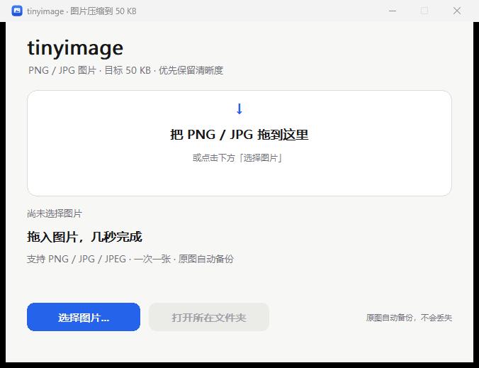

# tinyimage

把一张 PNG / JPG 图片压到 50 KB 左右的 Windows 小工具。原生 Win32 界面，单文件 exe（约 670 KB），不需要安装运行库。



## 使用

1. 双击 `tinyimage.exe`，把一张 `.png` / `.jpg` / `.jpeg` 拖进窗口；或点击「选择图片…」。
2. 程序在后台压缩，窗口不会卡住，完成后显示压缩前后的大小、尺寸和画质信息。
3. 原图改名为 `名字_bak.扩展名`，压缩结果沿用原文件名。例如：
   - `photo.jpg` → `photo_bak.jpg`（原图） + `photo.jpg`（压缩结果）
   - 如果 `photo_bak.jpg` 已存在，会自动使用 `photo_bak_2.jpg`、`photo_bak_3.jpg`……
4. 原图本来就不超过 65 KB 时，程序不会修改任何文件，只提示「无需压缩」。
5. 点击「打开所在文件夹」可以在资源管理器中定位结果。

也可以把图片直接拖到 `tinyimage.exe` 图标上，或从命令行启动：

```powershell
.\tinyimage.exe "D:\Photos\photo.jpg"
```

一次只处理一张图片；拖入多张时只处理第一张。支持的扩展名只有 `.png`、`.jpg`、`.jpeg`。

适用于 64 位 Windows 10 / 11。exe 没有代码签名，首次运行时 Windows 可能提示「未知发布者」，选择「更多信息」→「仍要运行」即可。

## 压缩规则

- 目标 50 KB，通常落在 35–65 KB，绝对不超过 100 KB。
- 优先保留清晰度：先尝试较大的尺寸和较高的 JPEG 质量，放不下时再逐级缩小。
- 为了保住清晰度，结果通常会靠近 65 KB 上沿，而不是刚好 50 KB；本身容易压的图片会更小。
- JPG 仍然输出 JPG；PNG 仍然输出 PNG，透明通道会保留，不会转成 WebP。
- PNG 使用索引调色板（最多 256 色）和 `tRNS` 透明信息来控制体积；缩放前会预乘 alpha，避免透明边缘出现黑边。
- 输出会去掉 EXIF / ICC 等元数据；手机照片的拍摄方向会先纠正，再输出。

## 构建

需要 Rust MSVC 工具链（Windows）和 Windows SDK 的 `rc.exe`：

```powershell
cargo build --release
copy target\release\tinyimage.exe .\tinyimage.exe
```

生成的是独立 exe，只依赖 Windows 自带的系统 DLL。项目里的 `tinyimage.manifest` 用于启用 Per-Monitor V2 DPI 感知和现代文件选择框。`app.rc` 把 `assets/tinyimage.ico` 和版本信息嵌入 exe；窗口启动时也从同一个图标资源加载大/小图标，因此标题栏、任务栏和资源管理器里的图标保持一致。修改图标后可用 `powershell -ExecutionPolicy Bypass -File tools\make_icon.ps1` 重新生成 `.ico`。如果找不到 `rc.exe`，构建仍会继续，但 exe 不会带自定义图标。

想调整目标体积，可修改 `src/compress.rs` 顶部的 `TARGET_BYTES`、`ACCEPT_LOW`、`ACCEPT_HIGH`、`HARD_MAX`，然后重新构建。

运行测试：

```powershell
cargo test --release
```

## 项目结构

```text
src/main.rs         程序入口（隐藏控制台）
src/gui.rs          原生 Win32 自绘界面、拖放、文件选择、后台任务
src/compress.rs     JPEG / PNG 压缩、备份、安全写入
tinyimage.manifest  Windows 清单
app.rc              图标和版本信息资源
assets/tinyimage.ico  多尺寸应用图标
tools/make_icon.ps1   从矢量图形重新生成 .ico
build.rs            用 rc.exe 嵌入资源，并链接 Windows 清单
```

## 已知限制

- 仅支持 Windows。
- 不支持批量、文件夹、WebP、GIF、BMP 等。
- 噪点很多或细节极密的图片，为了达到 50 KB 会明显缩小分辨率。
- JPEG 使用 4:2:0 色度抽样和渐进式编码，适合照片；对极锐利的文字截图不如 PNG 合适。
